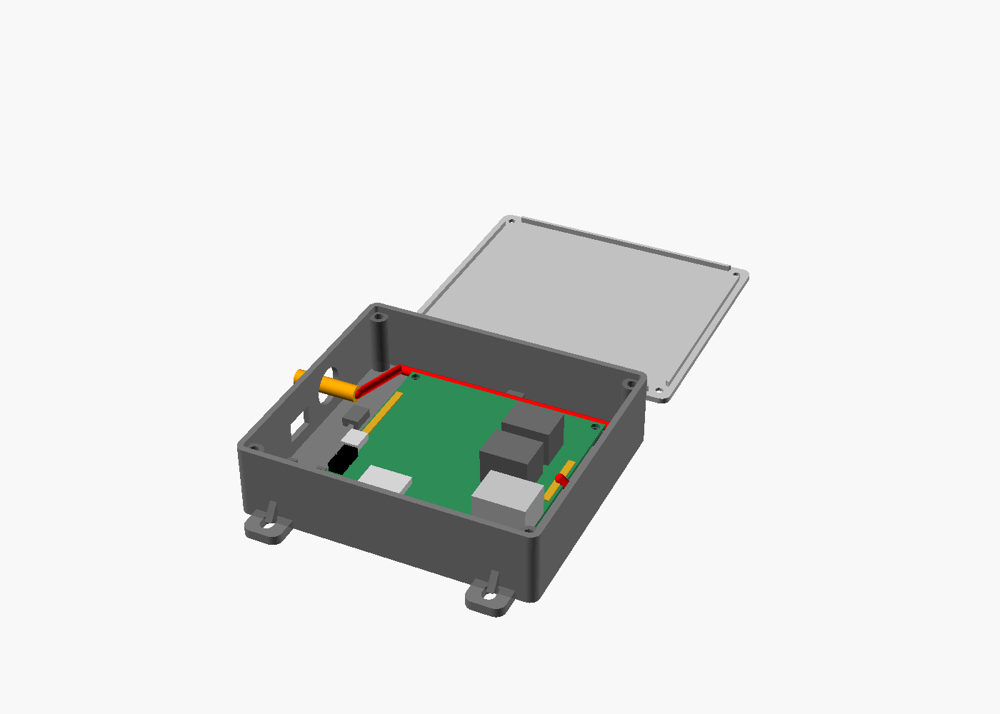

# PowerTune CAN relay box

An ESP32 board with relays and a CAN transceiver that turns the on-screen **CAN buttons** of a
PowerTune dash running [powertune-me442-custom-firmware](https://github.com/L1tPanda/powertune-me442-custom-firmware)
into real outputs. It's built for an MX-5 with a Motorsport Electronics ME442, whose firmware
(4.2.1) can't read custom CAN inputs:

- **MAP button** → relay 1 grounds the ECU's map-select input (Dig In 5, active low) → map 2
- **FAN button** → relay 2 grounds the fan relay coil, in parallel with the ECU → fan forced on

The box **keeps the button states itself** (through power cycles) and switches its outputs as soon as
the ignition comes on, without waiting for the dash to boot. It can also **sense** signals, e.g.
whether the ECU is running the fan, and the dash shows them as indicators.

Unofficial; not affiliated with PowerTune Digital or Motorsport Electronics. It connects to engine
management wiring: use at your own risk and test on the bench first. Licensed GPL-3.

## CAN protocol (500 kbps, 11-bit ids)

Needs dash patches 0003 and 0004.

**`0x6A1` dash → box** (10 Hz and on every tap)

| Byte | Meaning |
|---|---|
| 0-3 | CAN buttons 1-4 (0 / 1) |
| 4 | bit 0 = 1 once the dash has heard the box and shows its states |
| 7 | counter |

**`0x6A2` box → dash** (10 Hz, and straight away when an input changes)

| Byte | Meaning |
|---|---|
| 0-3 | the button states the box has saved and is driving |
| 5 | sensed inputs: bit 0 = "CAN input 1" ... bit 3 = "CAN input 4" |
| 7 | counter |

The box ignores `0x6A1` until byte 4 bit 0 is set, so a dash that is still booting (all buttons
off) can't undo the saved states. Once synced, a tap on the dash changes the state and the box
follows and saves it (ESP32 flash, NVS).

## Hardware

- **KinCony KC868-A2 V2.6**: ESP32, 2 relays (GPIO15, GPIO2), 2 opto inputs (GPIO36, GPIO39).
  The green terminal blocks are removed and the wires soldered to the pads.
- **SN65HVD230 CAN module** on the A2's I2C header: SDA (GPIO4) → CTX, SCL (GPIO16) → CRX,
  3V3 → 3V3, GND → GND. The header's 3.3 kΩ pull-ups don't affect CAN.
- **CAN termination:** with the ignition off, measure CAN-H to CAN-L on the loom. About 60 Ω means
  the bus is already terminated: remove the module's 120 Ω resistor (R2, marked "121").
- **Sensed inputs** (opto, active when pulled to ground):
  IN1 → ECU Dig In 5 (map 2 selected), IN2 → fan relay coil, ECU side (fan relay energised).

Other ESP32 boards work too: set `OUT_PIN`, `IN_PIN`, `CAN_TX` and `CAN_RX` at the top of the sketch.

## Firmware (`firmware/can_relay`)

Arduino, ESP32 core 3.x. With [arduino-cli](https://arduino.github.io/arduino-cli/):

```bash
arduino-cli compile --fqbn esp32:esp32:esp32 firmware/can_relay
arduino-cli upload --fqbn esp32:esp32:esp32 -p COM3 firmware/can_relay
```

Back up the board first if it holds anything you want to keep:
`esptool --port COM3 read_flash 0 0x400000 backup.bin`.

**Serial console** (115200 baud), for bench testing:

| Command | Does |
|---|---|
| `b1 on` / `b1 off` ... `b4` | change a button state, as if tapped on the dash (saved) |
| `selftest` | sends 5 frames out through the CAN module and reads them back: proves the module wiring with no other node on the bus |
| `status` | states, inputs, CAN error counters, dash frames |
| `pins` | checks the I2C header pull-ups, confirming the SDA/SCL pin numbers |

`RESTORE[]` picks which outputs come back on at power-up; set an entry `false` for an output that
should always start off (e.g. if every drive should start on map 1).

## Enclosure (`enclosure/`)



OpenSCAD source (`can_relay_box.scad`, parametric) and ready STLs for the A2:
**125 × 111 × 34 mm**, 4 slotted mounting ears and 2 strap slots. All wires leave through one M16
gland next to the USB-C slot (reflash with the lid on); the relay wires run along a channel at the
top edge. Zip-tie bridges take the strain off the soldered joints. Print in PETG or ASA, not PLA.
Build notes: [`enclosure/PRINT_NOTES.md`](enclosure/PRINT_NOTES.md).

## Testing without the car

The [powertune-dash-emulator](https://github.com/L1tPanda/powertune-dash-emulator) has
`fake_relay_box.py`, which behaves like this box over UDP.
